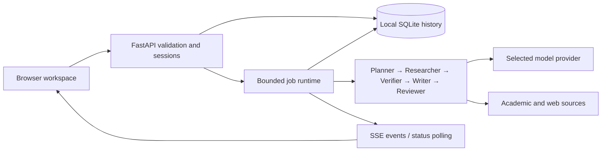

# Noevra

A local, provider-independent research workspace. Ask a question, follow the five-stage research process, and inspect the report, evidence, source passages and unresolved findings.

[](https://github.com/gege010/Noevra/actions/workflows/ci.yml)

## Run locally

Install **Python 3.11 or newer** and Git. CI is configured for Python 3.11/3.12 on Windows and Linux. Then:

```sh
git clone https://github.com/gege010/Noevra.git
cd Noevra
python run.py
```

On Windows, use `py -3.11 run.py` if `python` is not available. On macOS/Linux, use `python3 run.py` when appropriate.

The first run creates `.venv` and installs the tested dependencies, so it needs internet access and may take several minutes. Later runs reuse the environment. No activation, Node.js, Docker, Redis, external database, or `.env` file is required. The launcher never overwrites your `.env`, existing `venv/`, or research data.

Open **http://127.0.0.1:8000**. Stop the application with **Ctrl+C**.

```sh
python run.py --install      # Install/update without starting the server
python run.py --check        # Check configuration and writable storage; no provider calls
python run.py --port 8001    # Use another port when 8000 is occupied
```

Only one application process may use a local research database at a time. To run a separate workspace, set a different `NOEVRA_DATA_DIR` and port; changing the port alone does not create a separate database.

## Your first investigation

1. Open **Settings & customization → Connections**.
2. Choose a provider. Enter its API key, use supported OAuth, or connect a running Ollama/OpenAI-compatible server.
3. Select **Save & discover models**, then **Choose a model**. The list comes from that connection; search it by name or model ID.
4. Enter a research question, choose depth and source collections, then start.
5. Inspect **Report**, **Evidence**, **Sources**, and **Research process**. Download Markdown, PDF or BibTeX as needed.

The interface opens without a model account. Actual research needs a working model connection and internet access for source retrieval. A local LLM keeps inference local; academic/web searches still contact their source services. AI provider and search charges depend on your account and plan. OAuth is an account connection, not free inference.

Provider keys entered in the interface remain in tab memory. Reloading requires reconnection. For optional server credentials, copy `.env.example` to `.env` and fill only the providers you use. Restart after editing `.env`. Never commit this file.

| Connection | Authentication |
| --- | --- |
| Groq, DeepSeek | API key |
| OpenAI | API key; official local ChatGPT plan OAuth with a `127.0.0.1` callback |
| Anthropic | API key; Claude.ai subscription OAuth is not supported for this third-party use |
| Google Gemini | API key; Google OAuth when a web client and quota project are configured |
| OpenRouter | API key or PKCE OAuth |
| Ollama / custom | OpenAI-compatible endpoint; optional API key |

See [deployment and provider requirements](DEPLOYMENT.md) for the exact OAuth policies and setup. Available models and inference quotas are determined by each provider, not a bundled model list.

## Data and backups

By default, the workspace stores SQLite history and report content in `data/` beside this README. The folder is created automatically and is ignored by Git; committed example reports are historical fixtures, not seeded library entries. Starting the repository from another working directory uses the same data location.

Set `NOEVRA_DATA_DIR` to choose another location. Leave `DATABASE_URL` empty to keep the SQLite database there. An explicit relative SQLite URL is resolved against the application root. Docker uses its own persistent volume.

To back up the workspace, stop the application and copy the entire data directory. Downloads are generated from saved report content without a shared temporary export file. Restore the backup while the application is stopped. Local database files and server `.env` credentials rely on your operating system's file permissions; this is a personal workspace, not per-user encrypted storage.

## Docker alternative

With Docker and **Compose 2.24+** installed:

```sh
docker compose up --build
```

Open http://127.0.0.1:8000. `.env` is optional. A named volume persists container data across restarts and rebuilds; it is separate from the Python launcher's `data/`. Use `docker compose down` to stop the stack. Do not remove the data volume when you intend to retain history.

When a workspace password is configured, use **Lock workspace** in Settings to sign out and clear tab credentials.

The image runs as a non-root user and the port is bound to loopback. This container is for a single private workspace. See [DEPLOYMENT.md](DEPLOYMENT.md) before exposing it to other people or hosting it publicly.

## Troubleshooting

| Symptom | Action |
| --- | --- |
| Python command is missing | Install Python 3.11+; on Windows enable the launcher or PATH option. |
| Installation failed | Check internet/proxy access and folder permissions, then run `python run.py --install`. Linux distributions may require their `python3-venv` package. |
| Port 8000 is occupied | Stop the previous process, or choose `--port 8001`. A second Noevra process needs separate data storage. |
| Database is already in use | Stop the existing Noevra process; the lock releases automatically when its process exits. |
| Configuration check fails | Compare `.env` with `.env.example`; production requires HTTPS and workspace/session secrets. Do not paste secret values into bug reports. |
| No models appear | Connect a provider and refresh its catalog. Check account permissions and local endpoint reachability. |
| Ollama in Docker is unreachable | `localhost` refers to the container. On Docker Desktop use the host's reachable endpoint, commonly `http://host.docker.internal:11434/v1`, and configure the allowed origin when required. |
| Provider returns 429 or a session expires | Wait for quota reset or reconnect. The app never silently switches to another paid provider. |
| Research was interrupted | Reopen its status in Library. Restarted jobs are marked interrupted; start a new investigation after reconnecting. |

## Development and checks

The supported frontend is plain HTML/CSS/JavaScript served by FastAPI. Node.js is needed only for frontend utility tests, not to run Noevra. Development mode intentionally keeps one worker; automatic reload interrupts active research.

After the launcher has installed the runtime:

```sh
# Windows
.venv\Scripts\python -m pip install -r requirements-dev.txt -c constraints.txt
.venv\Scripts\python -m pytest tests/unit
.venv\Scripts\python -m ruff check src tests run.py

# macOS / Linux
.venv/bin/python -m pip install -r requirements-dev.txt -c constraints.txt
.venv/bin/python -m pytest tests/unit
.venv/bin/python -m ruff check src tests run.py

# Node.js 22+ on either platform
node --test tests/oauth-client.test.cjs tests/provider-picker.test.cjs tests/ui-renderer.test.cjs
```

Tests use disposable databases, clear provider credentials from the test process, and block unmocked HTTP provider traffic. They do not spend your inference/search credits or alter your local research library. CI checks Windows and Linux on Python 3.11/3.12. Live OAuth consent, provider quotas and paid model quality require separate account-owner verification.

For a manual environment, install `requirements.txt` with `constraints.txt`, then run `python -m src` or `python -m src --check`. The old Streamlit client is archived under `frontend/`; its optional dependencies are in `requirements-legacy.txt` and it is outside the supported startup flow.

## Architecture



See [ARCHITECTURE.md](ARCHITECTURE.md) for ownership, lifecycle and invariants; [ENGINEERING-REVIEW.md](ENGINEERING-REVIEW.md) for the audit and verification record; and [DESIGN.md](DESIGN.md) / [UX-CONTRACT.md](UX-CONTRACT.md) for UI conventions.

## Research quality

Sources can include academic metadata, abstracts, preprints and web pages; they are not all peer-reviewed or full text. Evidence status records what the retrieved corpus supports or leaves unresolved. Regex filtering is not a complete prompt-injection defense. Automated review is not scientific peer review, and successful generation does not establish that every claim is correct. Inspect original sources before relying on a report. PDF export preserves Unicode text but does not typeset TeX like a scientific publishing system.

## License

MIT; see [LICENSE](LICENSE). Fonts and vendored frontend libraries retain their licenses under `src/static/`.
